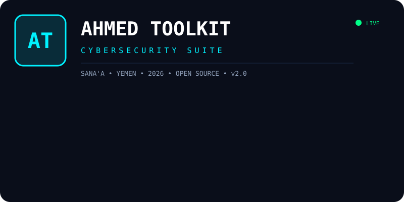

  

  
  
  
  

  
  

---

### 🚀 Ahmed Toolkit v3 - Professional Cybersecurity Suite

> Built with ❤️ from Sana'a, Yemen

#### ⚡ Quick Start
\`\`\`bash
git clone https://github.com/seemsosoy-source/ahmed-aljahdre.git
cd ahmed-aljahdre
python ahmed_toolkit.py
\`\`\`

#### 🛡️ Features
- 🔍 Port Scanner
- 🔐 Password Generator
- 🌐 IP Lookup
- 📡 Network Tools

---

⭐ Star this repo if you like it! ⭐

